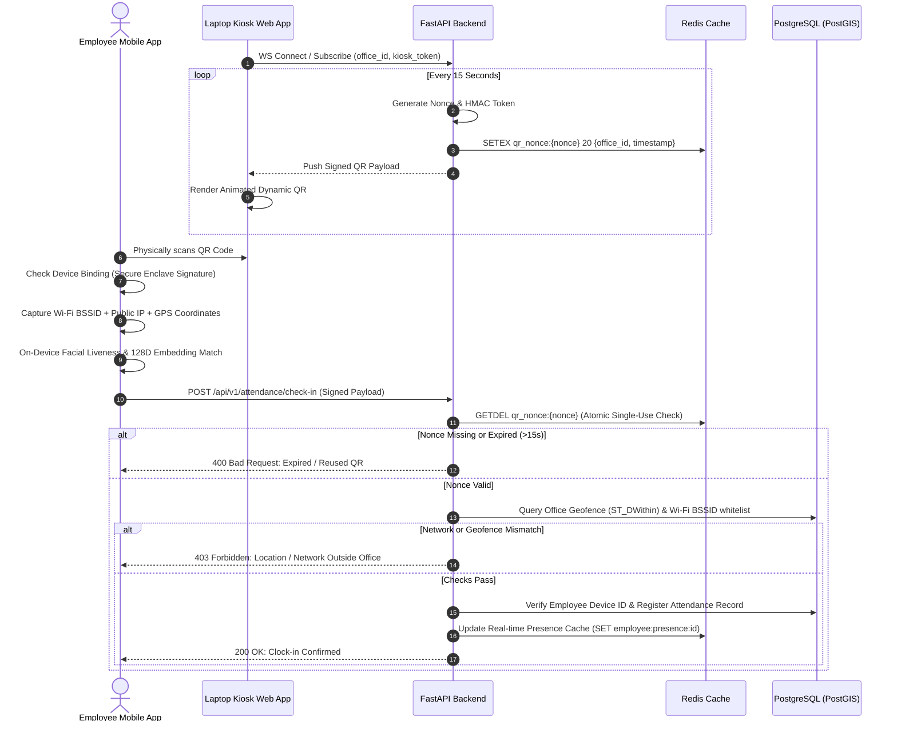
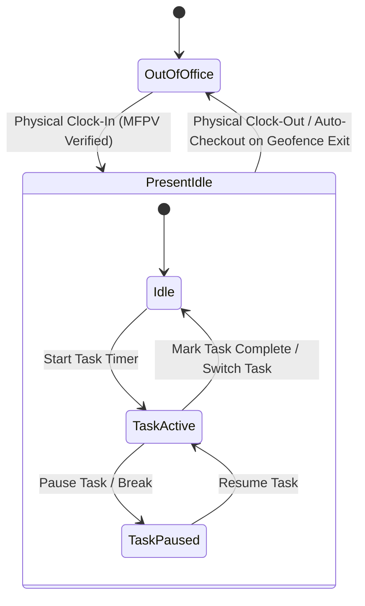

# ZuiGO Attendance & Task Tracking System — Architecture Specification

## 1. Executive Problem Statement & Goals

Traditional attendance systems rely on either:
1. **Expensive Biometric Hardware:** High capital expenditure, maintenance hassles, queue bottlenecks, and hygienic friction.
2. **Self-Declared Software Check-Ins:** Vulnerable to remote marking, GPS mocking, VPNs, and proxy attendance (coworkers marking attendance on behalf of each other).

**ZuiGO Attendance System** eliminates hardware requirements completely while achieving **hardware-grade trust** through a **Multi-Factor Physical Presence Verification (MFPV)** protocol.

---

## 2. Multi-Factor Physical Presence Verification (MFPV) Protocol



### 2.1 The 5 Zero-Trust Pillars

#### Pillar 1: Dynamic Rotating Cryptographic QR (Kiosk Display on Laptop)
* **Frequency:** 15 seconds validity window (with 5 seconds server-side clock skew tolerance).
* **Payload Structure:**
  ```json
  {
    "t_id": "tenant-uuid",
    "o_id": "office-uuid",
    "ts": 1730290000,
    "nonce": "a3f89b1c-7201-49b2-a42e-1904e5d8362b",
    "sig": "hmac_sha256_signature_hex"
  }
  ```
* **Single-Use Guarantee:** The backend executes `GETDEL qr_nonce:{nonce}` in Redis. Even if multiple phones scan the exact same QR code in the same fraction of a second, only the first request succeeds; subsequent requests are rejected.

#### Pillar 2: 1:1 Hardware Device Binding
* **Mechanism:** Upon employee invitation and initial setup, the React Native app generates an asymmetric key pair inside the phone’s hardware enclave (`react-native-keychain` / `expo-secure-store` with hardware-backed security).
* The public key and hardware identifier are securely transmitted to the server.
* Every subsequent attendance request must be signed with this private key.
* **Result:** No coworker can log into another employee's account on their phone to clock in for them.

#### Pillar 3: Network & Gateway IP Validation
* The mobile app queries `react-native-network-info` / `react-native-wifi-reborn` to extract:
  * Connected Wi-Fi **BSSID** (the physical MAC address of the office router/access point).
  * Connected Wi-Fi **SSID**.
* The server inspects:
  * The incoming HTTP request's **Remote Public Gateway IP**.
  * Matches BSSID against the database whitelist for that specific office branch.
* **Result:** Defeats GPS spoofing. Wi-Fi radio waves physically attenuate through concrete office walls; an employee cannot access the office BSSID from home or the street.

#### Pillar 4: OS Integrity & Mock Location Defense
* Native checks embedded into the React Native binary:
  * Checks `Location.isFromMockProvider()` on Android.
  * Root/Jailbreak detection (`jail-monkey` or `react-native-root-detection`).
  * Commercial VPN & HTTP proxy detection.
  * Blocks execution if the application is running inside an emulator or debugger.

#### Pillar 5: On-Device Facial Liveness Verification
* The employee's smartphone camera performs a 1-second passive liveness scan (validating pupil focus, micro-facial depth, blink).
* Generates a facial embedding vector on-device and compares it against the baseline embedding stored during onboarding (using cosine similarity $> 0.85$).
* **Result:** Completely eliminates proxy clock-in using printed photographs, digital screen displays, or videos.

---

## 3. Task & Work Time Tracking Subsystem

The task tracking engine provides full visibility into how time is spent during the workday without invasive monitoring.



### 3.1 Business Rules for Task Tracking
1. **Clock-In Dependency:** A user cannot start a task timer or log active hours unless their status is `PRESENT` in `attendance_records` for today.
2. **Single Active Task Constraint:** An employee can have at most one active running timer at any given moment. Starting a new task timer automatically pauses or completes the prior running timer.
3. **Automatic Clean-Up:**
   * Clocking out automatically closes the currently active task timer.
   * If an employee forgets to clock out, the system triggers a configured **Auto-Close Rule** at the end of the shift or after a maximum idle duration.
4. **Discrepancy Reporting:**
   * **Gross Attendance Hours:** `clock_out - clock_in`
   * **Productive Task Hours:** $\sum \text{task\_time\_entries}$
   * **Unallocated / Break Time:** Gross Attendance Hours - Productive Task Hours

---

## 4. Multi-Tenant Architecture & Data Isolation

### 4.1 Tenant Resolution
Tenants are resolved on every request via FastAPI middleware:
1. **Header Resolution:** `X-Tenant-ID: <tenant-uuid>` (for mobile API calls).
2. **Subdomain Resolution:** `https://acme.attendance.zuigo.ai` $\rightarrow$ resolves `acme` to `tenant_id`.

### 4.2 Row-Level Security (RLS) in PostgreSQL
Every tenant table includes a `tenant_id` column. The FastAPI database session middleware runs:
```sql
SET LOCAL app.current_tenant_id = 'c7e8e58a-3642-4f30-8025-4b0717fb0534';
```
PostgreSQL automatically appends `WHERE tenant_id = current_setting('app.current_tenant_id')` across all queries, preventing any cross-tenant data leaks.

---

## 5. Technology Stack Decisions

| Layer | Technology | Primary Rationale |
| :--- | :--- | :--- |
| **Backend Framework** | **Python FastAPI (3.11+)** | High-performance asynchronous execution, native Pydantic validation, rapid development of secure micro-services, seamless integration with scientific/ML libraries. |
| **Relational Database** | **PostgreSQL 16 + PostGIS** | Sub-millisecond geospatial geofencing (`ST_DWithin`), native Row-Level Security (RLS) for multi-tenancy, strict ACID compliance for attendance and payroll data. |
| **In-Memory Cache** | **Redis 7** | Sub-millisecond token nonces with automatic TTL expiration, atomic `GETDEL` operations to prevent token replay, and real-time live presence caching. |
| **Mobile Client** | **React Native / Expo** | Cross-platform (iOS & Android) with direct access to hardware Secure Enclave, Wi-Fi BSSID APIs, and on-device ML Vision frameworks. |
| **Office Kiosk** | **Vite + React (TypeScript)** | Extremely lightweight SPA running in fullscreen browser mode on any existing office laptop without requiring specialized hardware. |
